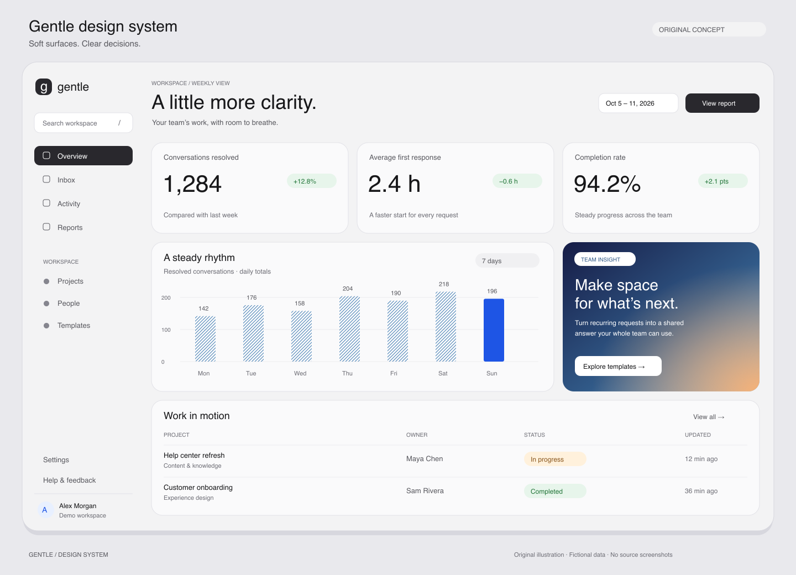

# Skills

个人维护的通用 AI Agent skills 集合，收集可跨项目复用的方法、工作流、规范和资源。每个 skill 独立说明能力、适用场景和使用方式，不依赖特定项目或本地环境。

## Skill 列表

| Skill | 简介 | 适用场景 | 资源 |
| --- | --- | --- | --- |
| [gentle-design-system](gentle-design-system/SKILL.md) | **柔和极简数据风**：灰白表面、细边框圆角卡片、克制排版、语义配色与纹理图表 | SaaS 后台、数据仪表盘、列表、详情与预测页面；可适配不同技术栈 | [设计 token](gentle-design-system/assets/tokens.json) · [CSS](gentle-design-system/assets/tokens.css) · [预览](gentle-design-system/assets/preview.png) |
| [game-sutdio](game-sutdio/SKILL.md) | 游戏全流程交付：需求与设计确认、可玩原型、完整体验样段、内容扩充、测试试玩与反馈迭代 | 新游戏策划、已有游戏阶段推进与单项修复；按目标选择引擎和平台 | [阶段交付与验收](game-sutdio/references/lifecycle.md) |
| [adobe-spectrum-design-system](adobe-spectrum-design-system/SKILL.md) | Adobe Spectrum 2 设计与实现指南：官方 token、组件状态、应用布局与桌面信息密度 | 用户明确指定 Spectrum 的产品设计、实现与界面审查；适配既有技术栈 | [官方资源与 Demo](adobe-spectrum-design-system/references/official-resources.md) · [布局与验收](adobe-spectrum-design-system/references/desktop-and-quality.md) |

## Gentle Design System

让数据密集的界面更安静、更清楚。Gentle 通过留白、数字层级和细腻的表面区分组织内容，以少量颜色提示实际值、风险、损失与改善，再用局部渐变突出值得关注的洞察。

它是一套供 Agent 使用的设计系统 skill，包含设计约束、token 和实现指南，可融入已有项目的品牌与技术栈。



*以上为重新设计的静态概念预览，品牌、人员与数据均为演示内容。公开仓库不包含原始参考稿。预览的 [SVG 源文件](gentle-design-system/assets/preview.svg) 可编辑。*

### 包含什么

| 内容 | 说明 |
| --- | --- |
| [基础规范](gentle-design-system/references/foundations.md) | 颜色、字体、数字、空间、圆角、阴影和图标 |
| [组件规范](gentle-design-system/references/components.md) | 导航、指标卡、表格、筛选、洞察卡、弹窗、情景开关及交互状态 |
| [图表语言](gentle-design-system/references/charts.md) | 纹理柱图、瀑布、桥接图、点阵、热力矩阵和预测趋势 |
| [页面布局](gentle-design-system/references/layouts.md) | 六类页面配方、响应式适配和跨业务迁移 |
| [平台映射](gentle-design-system/references/platforms.md) | 平台适配原则，以及 Web / Flutter 的可选实现参考 |
| [验收清单](gentle-design-system/references/quality.md) | 视觉一致性、数值正确性、可访问性和状态检查 |

### 安装

克隆此仓库，将所需 skill 的整个目录复制到 Agent 的 skills 目录。例如，使用 Codex 默认个人目录：

```bash
git clone https://github.com/leoskey/skills.git
mkdir -p ~/.codex/skills
cp -R skills/gentle-design-system ~/.codex/skills/
```

如果设置了自定义 `CODEX_HOME`，复制到该目录下的 `skills/`。如果已经安装了同名 skill，先检查本地修改，再决定是否替换。

### 使用

在支持 skill 调用的 Agent 中明确指定名称和任务：

```text
使用 $gentle-design-system 设计一个浅色数据界面，包含导航、指标卡片和记录列表。
```

```text
使用 $gentle-design-system 设计分析页，包含摘要指标、趋势图、记录列表和详情弹窗。
```

```text
按照 $gentle-design-system 审查这个页面，指出具体差异，并修复本次范围内的问题。
```

设计 token 是根据视觉参考估算、规范化后的实现起点；响应式与无障碍规则是为复用补充的建议。它不是成品组件库，落地后仍需在目标项目中验证布局、交互和数据。

## Game Sutdio

从概念与需求访谈开始，确认设计和本轮实现范围，再分阶段制作、测试、试玩并评估反馈。适用于不同引擎、平台和游戏类型；仅讨论或调整流程时，不启动游戏开发。

### 安装与使用

克隆仓库后，将整个 `game-sutdio/` 目录复制到 Agent 的 skills 目录。Codex 默认个人目录为 `~/.codex/skills/`；自定义 `CODEX_HOME` 时使用其 `skills/` 子目录。替换已安装版本前，先检查本地修改。

```bash
cp -R skills/game-sutdio ~/.codex/skills/
```

```text
使用 $game-sutdio，先访谈并整理游戏需求，向我展示具体摘要，确认需求与设计后再开始实现。
```

```text
使用 $game-sutdio，核对这个游戏已确认的需求、设计和授权范围，继续当前批次，并提供测试与试玩证据。
```

阶段产物、验收标准与反馈处理见 [阶段交付、验收与反馈循环](game-sutdio/references/lifecycle.md)。

## Adobe Spectrum Design System

基于 Adobe Spectrum 2 官方资源整理的独立 Agent skill，先明确任务结构与平台，再应用组件、语义 token 和视觉语言。包含桌面信息密度、键盘操作及渲染验收指导，不是 Adobe 官方发布包，也不是完整应用或 Figma 套件。

将整个 `adobe-spectrum-design-system/` 目录复制到 Agent 的 skills 目录即可使用；Codex 默认位置为 `~/.codex/skills/`，设置了 `CODEX_HOME` 时使用其 `skills/` 子目录。替换同名版本前先检查本地修改。

```text
使用 $adobe-spectrum-design-system 设计一个数据管理工作台，保留现有技术栈并验证桌面布局与键盘交互。
```

从 [官方资源与 Demo](adobe-spectrum-design-system/references/official-resources.md) 开始，按需阅读 [桌面布局与验收](adobe-spectrum-design-system/references/desktop-and-quality.md)。规范、组件与 token 的版本需在落地时再次核对。
